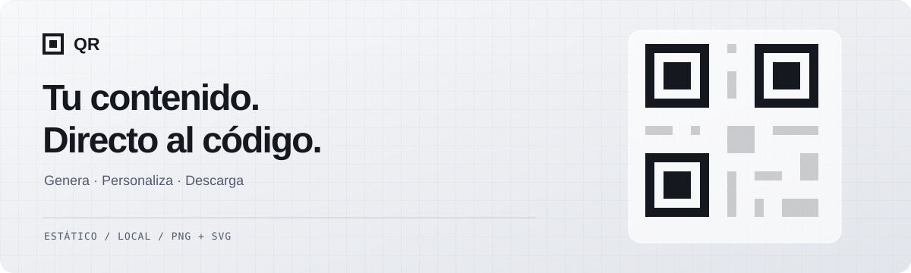

<div align="center">



# Generador de QR

**Códigos estáticos. Diseño propio. Procesamiento local.**

Genera, personaliza y descarga códigos QR cuyo contenido se codifica directamente en tu navegador.
Sin cuentas, publicidad ni redirecciones gestionadas por este proyecto.

[](https://github.com/JCastilloPadilla/generador-de-QR/actions/workflows/ci.yml)


[](LICENSE)

[Abrir el generador](https://qr.ccastillo.dev/) · [Empezar en local](#ejecutarlo-en-local) · [Arquitectura](docs/ARCHITECTURE.md) · [Despliegue](docs/DEPLOYMENT.md) · [Contribuir](CONTRIBUTING.md) · [Reportar un problema](https://github.com/JCastilloPadilla/generador-de-QR/issues/new/choose)

</div>

## Un QR que contiene lo que ves

La aplicación muestra la cadena exacta que se está codificando. Una URL queda grabada como URL;
una red WiFi, como sus datos de conexión. No se crea un enlace corto propio que dependa de
un servicio de redirección.

Los códigos no tienen una caducidad impuesta por el generador. Si apuntan a una página,
su utilidad sigue dependiendo de que esa página esté disponible.

## Qué puedes hacer

| Contenido | Opciones |
| --- | --- |
| Enlace y texto | URLs directas y texto libre, incluidos acentos y emoji. |
| WiFi | Nombre de red, seguridad y contraseña. |
| Contacto | Nombre, teléfono, correo y empresa en vCard. |
| Llamada y SMS | Número de teléfono y mensaje preparado. |
| Correo | Destinatario, asunto y cuerpo. |
| Ubicación | Coordenadas geográficas. |
| Evento | Título, fechas, lugar y descripción. |

- **Personaliza el patrón:** módulos cuadrados, redondeados, de punto o fluidos; esquinas cuadradas, redondeadas, circulares o de hoja.
- **Elige los colores:** frente, fondo y un color independiente para las esquinas.
- **Añade un logo:** se procesa localmente y activa automáticamente la corrección de errores H.
- **Descarga PNG o SVG:** PNG de 256, 512, 1024 o 2048 px; SVG vectorial para escalar.
- **Comprueba la lectura:** un lector local verifica una representación del diseño a 512 px, con sus formas, colores y logo. Informa del resultado sin bloquear la descarga.

> La verificación en pantalla es una ayuda, no una garantía de lectura impresa. Antes de imprimir,
> prueba el archivo final al tamaño real con la cámara de tu teléfono.

## Privacidad por diseño

El contenido, los datos de conexión y el logo se procesan en el dispositivo. La aplicación
no incorpora backend, cuentas, publicidad ni analítica de escaneos. Las dependencias se empaquetan
con el sitio; no se necesitan APIs externas para generar o verificar códigos.

Una vez cargados los recursos de la aplicación, puedes seguir generando y descargando sin conexión
en esa pestaña. No incluye instalación PWA ni garantiza una nueva carga sin internet.

Esto describe el generador: abrir el destino de un QR puede conectarte a servicios externos,
y el servidor que aloje el sitio puede conservar sus propios registros de acceso.

## Ejecutarlo en local

Necesitas **Node.js 22.13 o superior** y npm (recomendado: la última versión 22 LTS).

```bash
git clone https://github.com/JCastilloPadilla/generador-de-QR.git
cd generador-de-QR
npm ci
npm run dev
```

Abre la dirección que muestre Vite, elige el tipo de contenido y completa sus campos.
La vista previa se actualiza mientras escribes; después puedes ajustar el diseño y descargarlo.

| Comando | Uso |
| --- | --- |
| `npm run dev` | Servidor de desarrollo. |
| `npm test` | Suite de pruebas. |
| `npm run test:watch` | Pruebas en modo observación. |
| `npm run build` | Comprobación de tipos y compilación estática en `dist/`. |
| `npm run preview` | Revisión local de la compilación. |

## Tecnología y arquitectura

**TypeScript + Vite**, interfaz con DOM nativo y CSS. React se utiliza en el fondo animado,
que se carga por separado. `qrcode` calcula la matriz y `jsQR` comprueba la lectura local.

```text
Campos → contenido final → matriz QR → geometría compartida → canvas / SVG
                                                                  │
                                                     verificación y descarga
```

El renderizado propio permite personalizar las formas y conservar una geometría común entre
PNG y SVG. Las pruebas cubren serialización, escapados, geometría, contraste y decodificación.
GitHub Actions ejecuta las pruebas y la compilación en cada push a main y pull request.

- [Arquitectura y límites de la verificación](docs/ARCHITECTURE.md)
- [Despliegue estático con Nginx](docs/DEPLOYMENT.md)
- [Guía de contribución](CONTRIBUTING.md)
- [Comunicación de vulnerabilidades](SECURITY.md)

## Alcance y licencia

El proyecto se centra en códigos estáticos y procesamiento local. Los códigos dinámicos,
las cuentas y la analítica de escaneos quedan fuera de su alcance.

Distribuido bajo la [licencia MIT](LICENSE). Puedes usar, modificar y redistribuir el
proyecto, incluso comercialmente, conservando el aviso de autoría y la licencia.
Las dependencias mantienen sus propias licencias.

---

Creado por [JCastilloPadilla](https://github.com/JCastilloPadilla).
